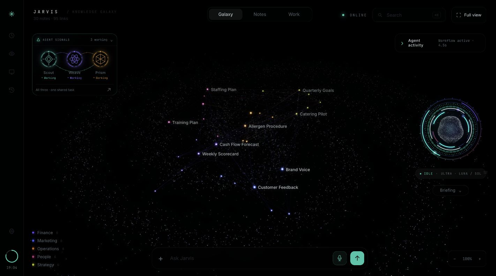

# Jarvis · Ultra Jarvis

A personal AI assistant that connects a Markdown knowledge vault, a 3D galaxy, voice and a bounded team of collaborating agents.

[](https://github.com/fwnivaen/Jarvis/actions/workflows/ci.yml)



Jarvis runs on a local Python server with a plain JavaScript viewer and native macOS helpers. Notes, search indexes and runtime state live on your machine. Model requests use the signed-in ChatGPT/Codex account and require a verified included allowance; separately billed API providers are disabled. Selected note excerpts and explicit vision frames can leave the machine. The included 30-note café vault is fictional demonstration data. See the [usage policy and its limits](docs/usage-policy.md).

## What it does

- **Grounded knowledge:** search Markdown notes, follow citations into the galaxy, capture new notes and edit with revision checks.
- **Collaborative agents:** a boss assigns work to up to three workers, shares their findings, checks their reports and returns one answer. Simple requests use a single cheaper call.
- **Live activity:** compact Scout, Weave and Prism signals glow as agents work and connect around shared findings. The existing drawer and Work view show tools, timing, retries and reported tokens. Private reasoning is never displayed.
- **Hybrid memory:** local semantic and keyword search, PDF/DOCX/XLSX text imports, and preferences that persist across sessions.
- **Voice and vision:** an animated orb, browser/native speech, local posture landmarks, explicit camera questions and screen watch with local frame comparisons.
- **Mac assistant:** global hold-to-talk, reviewed dictation, instant app/web/window/Music commands, explicit saved routines, and a dashboard with recent action results.
- **Shared tools:** 10 note, preference, document and screen-watch tools available to the crew and an MCP stdio client.

## Engineering highlights

The orchestration uses typed JSON contracts and local checks for source quotations and arithmetic. Workers share fixed deadlines, retry limits and one request-wide escalation budget. Failed work remains visible; partial answers are labelled. Checkpoints retain validated work and original budgets, and a durable tool journal prevents retries from repeating the same write.

The viewer has no frontend build step. Its custom Three.js renderer batches note geometry, preserves cached layouts as the vault grows and pauses when hidden. Sensor permissions remain explicit, posture inference stays in the browser, and the server binds only to loopback.

The core server and legacy crew use Python's standard library. Explicit Work-tab workflows use optional LangGraph and SQLite checkpoint packages. Optional search, document and MCP packages install inside a project-local virtual environment. CrewAI-style delegation and peer review are implemented directly rather than adding a second orchestration framework.

## Run on macOS

You need Python **3.11+** for the complete upgrade, Chrome, Apple command-line tools for the native helpers, and an installed, signed-in [Codex CLI](https://github.com/openai/codex). Node.js is needed only for the regression checks. Model availability depends on the signed-in account.

```sh
git clone https://github.com/fwnivaen/Jarvis.git
cd Jarvis
python3 tools/setup_ultra.py
python3 tools/ultra_settings.py enable
./start.sh
```

Open [localhost:4700](http://localhost:4700). The launcher builds and opens **Jarvis Desktop** on macOS; hold **Control + Option + Space** to talk or **Control + Option + D** to dictate. The ⌘ rail button opens the Mac assistant dashboard. [Desktop features and setup](docs/mac-assistant.md). Setup downloads the optional local embedding model. The server creates its private configuration when missing; no API key is required for the Codex backend. Ultra is opt-in in the committed configuration, and disabling it restores the original route.

To inspect the galaxy without installing the optional packages or compiling native helpers:

```sh
python3 build.py
python3 server.py
```

This starts the original path. Cloud answers still require a configured, available backend. See the [complete setup guide](ULTRA-JARVIS.md) for Python selection, tools, flags and troubleshooting.

## Visible agent workflows

Run `./start-workflows.sh` after setup, open [localhost:4700](http://localhost:4700), and select **Work**. Launch a task, follow real parallel agents and tool activity, inspect verified findings, cancel work, or retry a saved checkpoint within its original budget. Return to **Galaxy** to watch the compact three-agent constellation. LangGraph runs locally through the existing signed-in model connection; no hosted Studio is required. [Setup and controls](docs/WORKFLOWS.md) · [Agent visuals and checks](docs/agent-visuals.md) · [Measured comparison](docs/framework-evaluation.md).

## Try it

- “Who updates the Cash Flow Forecast, and when?”
- “Use three workers to compare Menu Pricing, Opening Checklist and Launch Campaign.”
- “Remember that the supplier review is next Tuesday.”
- Import a document from Notes, or add an explicit preference in Settings.

The legacy chat crew's default model configuration uses a **Sol max** coordinator, with **Sol medium**, **Luna max** and **Luna high** workers. These remain runtime profiles; the Galaxy display uses three equal agent symbols. Exact model IDs and efforts are validated against the installed account catalog. The worker cap is configurable; the default deadline is 45 seconds with at most two retries and one escalation per request. Astra is manual-only in the Ultra route.

## Verify it

```sh
python3 tools/check_repo.py
python3 tools/check_ultra.py --embeddings
python3 preflight.py
```

The first two commands check repository hygiene and the regression suite. Full preflight requires the running Mac server, performs real model calls and cleans up its own temporary capture. CI runs the automated suite without account credentials or physical sensor access and builds the native helpers on macOS.

The October 25 Mac assistant integration passes **280 Python tests with zero skips** in the optional CPython 3.12 environment with local embeddings enabled, plus **13 JavaScript suites**. Full live preflight reports **14 pass, 0 fail, 2 warn**; both warnings skip separate API-provider checks because Codex sign-in is active. Focus, its tracking loop, native card, commands, tools, assets, and probe are removed. The visible dashboard was checked in Chrome; physical hotkeys, microphone, insertion, window control and audible playback still need an unlocked Mac and the required permissions. [Integration scope and evidence](docs/mac-assistant.md).

The official Deep Agents helper, durable execution controls, browser-worker preparation, offline GEPA/evaluation and reviewed promotion boundaries are implemented and fixture tested. New optional features stay off. **No remote deployment, live Deep Agents provider comparison, learning benefit, 24-hour soak or Mac-off independence is verified.** Oracle provisioning is blocked by the unavailable verified account. [Capability status and measurements](docs/upgrade-results.md) · [Persistent checklist](docs/upgrade-checklist.md) · [Evidence ledger](docs/upgrade-evidence.md) · [Contracts](docs/upgrade-contracts.md) · [Deployment instructions](deploy/remote/README.md).

Max-effort workers can reach the 45-second limit; the system returns an explicitly partial result. Document imports extract text rather than OCR or chart images. General computer control and email sending are not exposed by the tool registry. Physical audio, camera accuracy and macOS permissions require local acceptance testing.

## Explore the code

| Area | Start here |
| --- | --- |
| HTTP boundaries, retrieval and existing behavior | [server.py](server.py) |
| Routing, budgets, validation and collaboration | [ultra.py](ultra.py), [codex_bridge.py](codex_bridge.py) |
| Memory and document conversion | [ultra_memory.py](ultra_memory.py), [ultra_documents.py](ultra_documents.py) |
| Shared tools and checkpoint recovery | [ultra_tools.py](ultra_tools.py), [ultra_workflows.py](ultra_workflows.py) |
| Galaxy, orb and live crew | [viewer/](viewer/) |
| Mac assistant, voice and desktop helpers | [assistant_actions.py](assistant_actions.py), [voice_bridge.py](voice_bridge.py), [native/](native/) |
| Regression checks | [tests/](tests/), [CI workflow](.github/workflows/ci.yml) |

[Architecture](docs/ARCHITECTURE.md) · [Usage](docs/USAGE.md) · [Documentation index](docs/README.md) · [Third-party notices](THIRD_PARTY.md)
