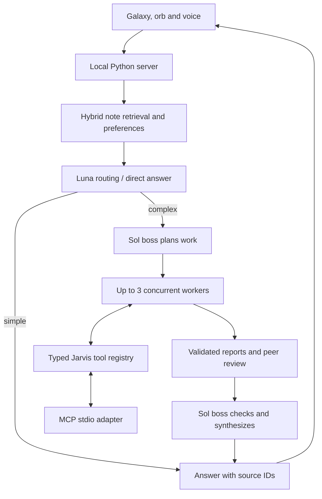

# Architecture

Jarvis extends one local application rather than running separate assistants behind unrelated interfaces. The viewer sends requests to the loopback server; existing note, voice and vision paths remain available when Ultra is disabled.

## Request lifecycle

1. The HTTP boundary validates the local host/origin, input shape and size. Retrieval supplies actual note excerpts and explicit saved preferences.
2. Simple questions are classified and answered in one Luna call. Explicit worker requests skip cheap classification and go directly to the boss. Manual model choices preserve the original override behavior.
3. The boss creates complementary assignments. Stable worker slots use the configured model/effort profiles and one bounded pool. Workers exchange validated reports and review available peers without waiting for the slowest draft.
4. Source IDs, exact quotations, output types and restricted arithmetic are checked locally. Only objective failures can consume the shared Luna-to-Sol promotion budget. Confidence and timeouts cannot trigger promotion.
5. The final boss receives the collected reports and retrieved passages. Executable tools are disabled during synthesis to prevent repeated operations. Failed workers and unfinished boss review are disclosed.
6. The response retains the existing answer/source contract, so citations, galaxy highlighting, camera motion and speech continue through the existing controllers.

## Boundaries and implementation choices

| Component | Responsibility |
| --- | --- |
| [server.py](../server.py) | Loopback HTTP, existing backends, bounded requests, local tool adapters and graph refresh |
| [build.py](../build.py), [note_store.py](../note_store.py) | Markdown graph creation, revision-checked reads and durable edits |
| [ultra.py](../ultra.py) | Feature flags, routing, worker profiles, objective validators and request/worker budgets |
| [codex_bridge.py](../codex_bridge.py) | One warm app-server connection, ephemeral threads, catalog checks and fixed dynamic-tool dispatch |
| [ultra_monitor.py](../ultra_monitor.py) | Allowlisted activity metadata shared by the viewer and terminal |
| [ultra_memory.py](../ultra_memory.py) | Lazy local embeddings, embedded Qdrant, keyword fusion and explicit preferences |
| [ultra_documents.py](../ultra_documents.py) | Bounded PDF/DOCX/XLSX extraction with provenance and repeat-import protection |
| [ultra_tools.py](../ultra_tools.py) | Typed tool validation and durable write deduplication |
| [ultra_workflows.py](../ultra_workflows.py) | Workflow templates, private checkpoints and observed evaluation summaries |
| [tools/ultra_mcp.py](../tools/ultra_mcp.py) | Standard stdio MCP adapter over the same tool registry |
| [viewer/galaxy.js](../viewer/galaxy.js), [viewer/layout-worker.js](../viewer/layout-worker.js) | Batched rendering, stable cached positions, picking and lifecycle control |
| [assistant_actions.py](../assistant_actions.py), [sensor_state.py](../sensor_state.py) | Explicit local commands, durable replay receipts, saved routines and expiring camera booleans |
| [native/](../native/) | Swift speech, global shortcut/dictation companion and screen-watch indicator |

There is no frontend dependency installation or build pipeline. Fonts, rendering libraries and posture assets are bundled with their notices. Optional Python integrations load only when their feature is enabled; failures retain the original keyword or chat behavior where applicable.

## Failure and recovery semantics

Each worker has a single deadline covering draft, peer wait, review, retries and promotion. A separate request budget covers the whole pipeline, including both boss calls. Recovery never replenishes those limits. Cached completed or partial answers need no model call and preserve the observed worker states and token totals.

Checkpoints store validated work products, context fingerprints, source revisions and counters. A changed question, source, preference, instruction or configuration cannot silently reuse a different run. Tool writes have pending/completed journal entries. Identical peer/retry writes are deduplicated; an uncertain interrupted write is not replayed automatically.

Monitor fields are fixed metadata such as model, phase, tool name and counters. Prompts, raw arguments, worker reports and private reasoning never enter the activity table. Token use is observed when the backend reports it; subscription token counts are not presented as a dollar bill.

## Data and permissions

The project configuration, private memory, journals, generated graph and personal captures/imports are ignored by Git. The HTTP static allowlist excludes private files. The checked-in vault contains fictional café notes for reproducible exploration.

Local posture inference sends boolean status to the server. Explicit vision requests can send one image to the configured model. Model requests can include selected note passages and preferences. Camera, microphone, display sharing and macOS automation retain their existing permission boundaries. Agent tools execute requested operations without an additional per-action approval drawer; the existing note editor retains its confirmation and revision checks.

The Mac assistant parses explicit commands into a small allowlist and passes argument arrays to installed apps or the native helper. No model-written shell is executed. Receipts are persisted before side effects, and ambiguous runs are never replayed. Voice commands require final recognition or manual review. Camera state expires independently; there is no foreground activity polling or timer.

## Scope

This is a personal local application, not a multi-tenant service. It accepts one user request at a time, with parallelism inside that request. Screen observation is implemented; unrestricted computer control, email sending, trading and unrelated business-service adapters are outside the connected tool set. Historical visual briefs and earlier measurements are retained in [archive/](archive/), separate from [current verification](ultra-verification.md).

## Durable Work-tab workflows

The Work workspace now has an explicit LangGraph route alongside ordinary chat. `workflow_graph.py` owns graph structure; `workflow_runtime.py` adapts the existing model connection, validators and read-only tool subset. The existing HTTP server exposes start/cancel/retry actions and bounded reconnectable event streams. SQLite saves graph state and per-agent budgets. Both routes share `BRAIN_SLOTS`, so a background workflow cannot add concurrent request-level model spending. The original chat crew and quick route remain available. See [workflow setup and boundaries](WORKFLOWS.md) and [measured selection](framework-evaluation.md).
