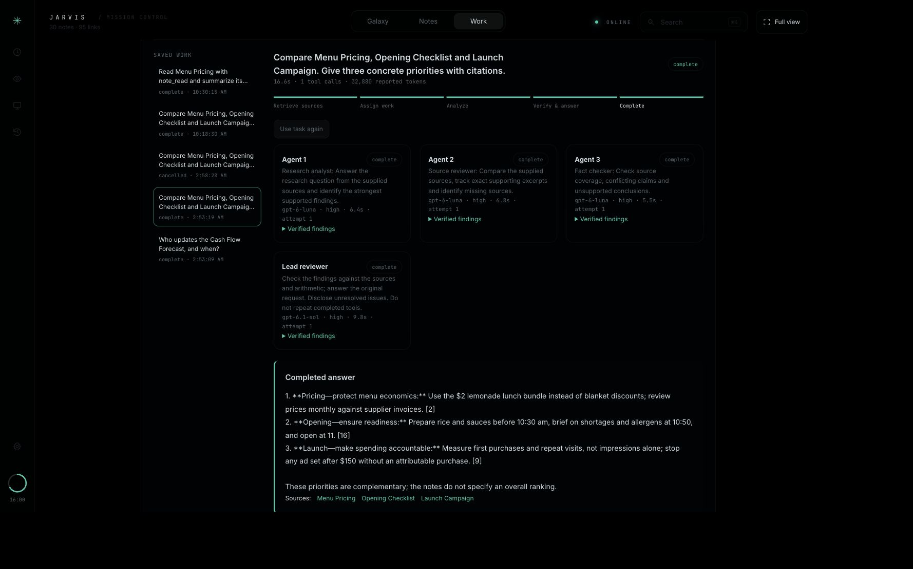
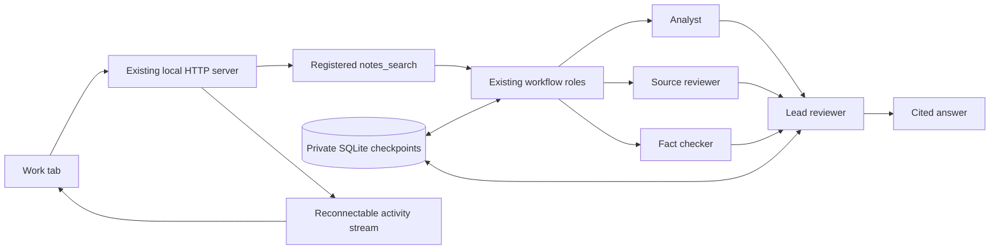

# Agent workflows inside JARVIS

The **Work** tab launches real LangGraph workflows through JARVIS's existing Codex model connection and note tools. It shows assignments, active agents, node progress, tool calls, verified findings, errors, elapsed time, reported tokens and the final cited answer. Closing the page does not stop a run. Reopening Work restores saved state. This is a local integration, not an embedded hosted Studio.



## Setup and launch

From the repository directory, with Python 3.11+ and the existing signed-in Codex CLI:

```sh
python3 tools/setup_ultra.py --no-model
./start-workflows.sh
```

Open **http://127.0.0.1:4700**, select **Work**, enter a task and choose **Launch workflow**. Stop an existing server on port 4700 before launching this one. `--no-model` skips downloading optional embeddings; keyword retrieval remains available. Omit that option to install the embedding model too.

The launcher creates `.local/workflow-settings.json` with Ultra, tools and workflows enabled. It derives other limits from `ultra.json`, leaves that committed configuration untouched, and uses the existing private `config.json` in place. Credentials are never copied to the viewer or checkpoints. The ordinary `./start.sh` path remains available. A missing workflow dependency produces a setup notice instead of replacing ordinary chat.

Try:

- **Focused answer:** “Who updates the Cash Flow Forecast, and when?”
- **Evidence research:** “Compare Menu Pricing, Opening Checklist and Launch Campaign. Give three concrete priorities with citations.”
- To exercise model-directed tools: “Compare Menu Pricing, Opening Checklist and Launch Campaign. Use note_read to verify their details. Give three priorities with citations.”

The included café notes are fictional. Document analysis works on text already imported through JARVIS's existing import function. Code review analyzes supplied note content; it does not execute code or claim tests ran.

## Controls and recovery

**Cancel workflow** signals every active model call, interrupts their turns, and prevents subsequent graph work. A read-only Python tool already running cannot be forcibly killed; its caller stops waiting and a separate bounded tool slot remains occupied until it returns. There are at most three such operations. Model startup/transport and interruption can add cancellation latency.

**Retry saved work** resumes the same graph checkpoint. Successful workers are retained. Attempt reservations, tool count, worker deadlines and the original request expiration persist. A retry does not replenish them. Changed settings or source revisions refuse recovery. Expired or exhausted runs require **Use task again** followed by **Launch workflow**, which is an explicit new request with a fresh budget. No run restarts automatically after a crash; it appears as interrupted for the user to inspect.

The current service permits one active user request, shared with ordinary chat, and up to three parallel analysts. Concurrent launches receive a visible busy response; they do not queue model spending. The default limits remain 45 seconds per analyst, 240 seconds per request, at most two additional attempts per agent, 24 read-tool calls and two manual recoveries within the original deadline. The reviewer shares the request deadline. No automatic model escalation is added.

## What runs



[workflow_graph.py](../workflow_graph.py) defines LangGraph nodes, parallel `Send` branches, their merge and final review. LangGraph schedules execution and saves checkpoints synchronously. [workflow_runtime.py](../workflow_runtime.py) adapts JARVIS's model transport, typed tools, source/math validators, persistent budgets and local HTTP lifecycle. It does not implement a second graph scheduler.

Analysts use the configured Luna model at high effort; the lead uses Sol at high effort. The existing workflow role templates make assignments without a separate paid planning call. Focused answer uses one analyst; research uses three; document/code review use two, subject to the existing worker cap. This differs from the legacy max-effort boss and mixed worker crew. The performance comparison therefore measures the whole approach, not LangGraph's isolated effect.

The new analysis runner exposes only `notes_search`, `note_read` and `preferences_get`. The original chat route retains its existing write-capable tool registry and deduplication journal. Keeping workflow recovery read-only avoids repeating writes after interruptions. Real graph transitions, model usage notifications and tool adapter events drive the console. Findings are validated before display. No private reasoning, raw model protocol, tool arguments or full tool results enter the activity feed.

## Local data and limits

`.local/graph-workflows/` holds a catalog and a checkpoint SQLite file for each run. The directory is mode 0700 and database files are mode 0600. Checkpoints include task text, source excerpts and work products, so they remain private local data. The HTTP static allowlist excludes this directory. Known configured keys and common secret patterns are removed from displayed tasks and outputs. This is not a general-purpose classifier for every possible secret embedded in arbitrary notes.

LangSmith tracing is explicitly disabled for graph execution, even if enabled in the shell environment. This installation uses neither Agent Server nor a LangSmith account/key/subscription. Calls to the existing model backend still send task context and selected note excerpts as before.

Storage accepts at most 50 runs and checks a 64 MiB database threshold before starting another run; an in-flight run may grow beyond the threshold. To archive history, stop JARVIS and move the entire private workflow directory to a private backup location. Do not publish it. The service then creates a new directory on launch/use. There is no multi-user access, public hosting, distributed queue, or unbounded retention.

Activity streams have bounded connection lifetimes and four simultaneous listener slots. Browsers reconnect and receive the full current snapshot plus the most recent 256 events; older event history is not promised. Findings stream when a validated node finishes, not token by token. Token counts are reported usage, not dollar charges. Interrupted calls can leave usage unknown; the UI labels partial accounting.

## Checks

```sh
python3 tools/check_repo.py
python3 tools/check_ultra.py --embeddings
.local/ultra-full-venv/bin/python tools/evaluate_workflows.py
python3 preflight.py
```

The benchmark and automated graph tests use isolated data and a synthetic model boundary with zero model spending. They execute the real LangGraph scheduler, SQLite persistence, JARVIS tool adapter and HTTP handlers. Full preflight uses the running local server, real model calls, and a temporary capture that it cleans up. The optional embedding check requires the downloaded model.

See [evaluation and upstream comparison](framework-evaluation.md) and [recorded measurements](framework-results.json). The integrated live trials are genuine model executions; automated failure injection is labelled separately.
