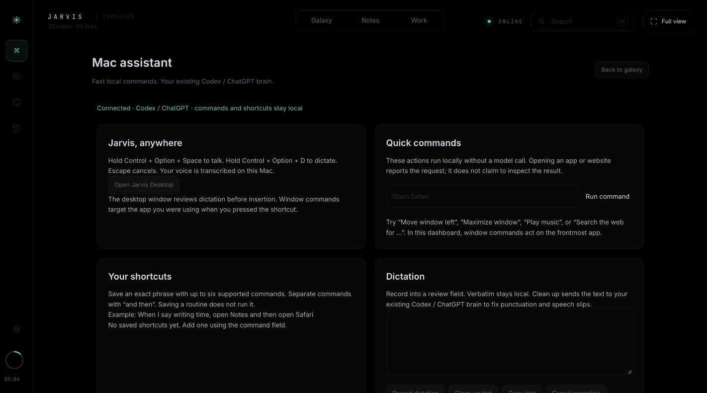

# Jarvis Mac assistant

The October 25 integration brings selected [Atticus Mac](https://github.com/SaarthurR/atticus-mac) features into the existing Jarvis application. The name, galaxy, notes, memory, workflows, voice orb and signed-in Codex / ChatGPT model connection remain Jarvis. Claude Code is not required.

## Open it

Run `./start-workflows.sh --adaptive-routing` for the existing adaptive workflow setup, or `./start.sh` for the configured standard route. On macOS, both launchers build updated Desktop/Voice helpers and open the menu bar companion without starting the microphone. Choose the **⌘ rail button** in the dashboard for **Mac assistant**. **Work** retains the existing durable background agents and their cancellation/retry controls.

If running `server.py` directly, build `sh native/build_desktop.sh` and `sh native/build_voice.sh`, then press **Open Jarvis Desktop** in the dashboard. The helper connects only to `http://127.0.0.1:4700` and needs the server running.

| Control | Behavior |
| --- | --- |
| Hold **Control + Option + Space** | Local speech recognition; release waits for a final transcript before asking Jarvis. An unconfirmed or timed-out transcript requires review and **Ask Jarvis**. |
| Hold **Control + Option + D** | Dictate into the companion's editable review field. It never inserts automatically. |
| **Ask Jarvis / Dictation** selector | Switch between questions and text editing. |
| **Clean up text** | Send only the dictated text to the existing Codex / ChatGPT connection to correct punctuation and speech slips; review the result. |
| **Copy / Insert reviewed text** | Copy, or explicitly insert into the original Accessibility text field. Unsupported fields require manual paste. No Return/send key is generated. |
| **Escape / Cancel / close** | Stop the microphone and discard pending callbacks. Already-started background tasks remain visible in Work. |

The helper registers its shortcuts with macOS. A conflicting shortcut produces a visible notice; typing and dashboard dictation remain available. The 60-second recording cap goes to review rather than automatically running a command.

## Instant commands and routines

These commands run locally without inference. Use them in the main Jarvis chat, the desktop companion or the Mac assistant command field.

| Say or type | Result |
| --- | --- |
| `Open Safari`, `Launch Notes`, `Open Chrome` | Request an installed app by exact name; Chrome is a Google Chrome alias. |
| `Open https://example.com` | Request a complete HTTP(S) address without embedded credentials. |
| `Search the web for …` | Open a browser search. |
| `Move window left`, `Move window right` | Place the original app's window on half its current display. |
| `Maximize window`, `Center window` | Place and read back the original app window's geometry. |
| `Play music`, `Pause music`, `Resume music` | Request playback control in Apple's Music app. |
| `When I say writing time, open Notes and then open Safari` | Save an explicit routine without running it. |
| `Writing time` | Run the saved routine. The dashboard also offers Run and Remove. |
| `Background task: compare the pricing notes` | Start the existing research workflow; follow, cancel or retry it in Work. |

Routines allow up to six built-in commands separated by **and then** or semicolons. They cannot contain shell, arbitrary AppleScript, sends, purchases, file deletion or general model-written instructions. Window steps always refer to the app captured at the start of the request; opening an app does not retarget later window steps. The dashboard uses the current frontmost app. Use the global shortcut while in the desired app to preserve that target.

App, URL and Music commands report **requested**, since launching an app is not proof of its final UI state. Window placement reports **confirmed** only after reading its geometry back. Failed routines retain completed steps and stop. A saved request receipt prevents a network retry or restart from repeating an action; ambiguous interrupted commands require inspection before a new request. Recent actions and shortcuts persist locally in the ignored assistant journal.

## Existing Jarvis integration

All inference continues through Jarvis's existing Codex CLI/app-server bridge and its signed-in ChatGPT usage policy. No Claude provider, extra API key, second agent framework or frontend build system is added. The architecture follows OpenAI's [app-server integration guidance](https://developers.openai.com/blog/codex-as-a-platform): the product keeps its UI and controls around a local Codex process. Existing model availability and included-usage checks continue to apply.

Verbatim recognition uses the existing on-device Apple speech helper. Cleanup and questions can send text to the configured Codex / ChatGPT backend; image questions retain their existing explicit screen/camera flow. The native companion does not silently read the screen. Larger jobs use the existing bounded workflows and live agent activity. Questions and “remember that” requests from the companion use the same note and memory endpoints as the dashboard.

Focus is removed throughout: no timer, foreground polling, drift accounting, retargeting, speech persona instructions, native card, tool/MCP entries, dashboard controls or Focus assets. `/focus` and `/focus/diag` return 404. Old ignored numeric ledgers are historical and are not loaded or updated. Eyes and screen watch retain their existing explicit controls; camera booleans now expire independently after their heartbeat stops.

## Permissions and verification

Microphone and Speech Recognition permissions belong to **Jarvis Voice**. Window placement and insertion need **Accessibility** for Jarvis Desktop or the launcher identified by macOS. Music may request **Automation** permission. Use the companion's **Accessibility permission…** menu item when needed. No permission is granted by the installer or verification fixtures.

Verified October 25:

- Both native helpers compile; the desktop helper builds without diagnostics on this Mac.
- **280 Python tests, zero skips**, with local embeddings enabled; **13 JavaScript suites** pass. New checks cover command admission, shell/URL refusal, save-without-run, persistence, request-key reuse, partial routines, duplicate suppression, HTTP origin checks, background handoff, dictation cleanup failure and expiring sensor signals.
- Browser voice regression checks require review for partial action commands. Native speech explicitly waits for final recognition before running commands.
- Full running-server preflight: **14 pass, 0 fail, 2 warn**. The two warnings skip separate API-provider checks because Codex sign-in is active. Real note chat, configured-model inference, model switching, capture/recall/cleanup and image inference passed. A separate live dictation-cleanup request also returned editable text through the existing Codex account.
- The visible Chrome dashboard loads with no Focus control, shows the Mac assistant panels, saves a temporary routine without launching its apps, and removes it. The companion launch request succeeded.

Physical microphone, global shortcut delivery, Accessibility insertion/window placement, Music permissions, multiple displays and audible playback remain unverified: native UI inspection was blocked because the Mac was locked. The implementation does not treat successful compilation or fixtures as physical acceptance.

The earlier Focus diagnostic was read before removal; its session was off and its foreground signal unavailable. The existing six numeric session records and legacy aggregate totals were inspected. The browser inventory exposed tabs but not a reliable window count. The verified dashboard host was `127.0.0.1:4700`. Earlier Focus probe records elsewhere in the documentation are historical and no longer acceptance gates.

Atticus's unrestricted computer automation, automatic command learning, meeting capture and drawing overlays are not added. The selected features fit Jarvis's existing controlled tools, durable workflows and explicit sensor permissions.
