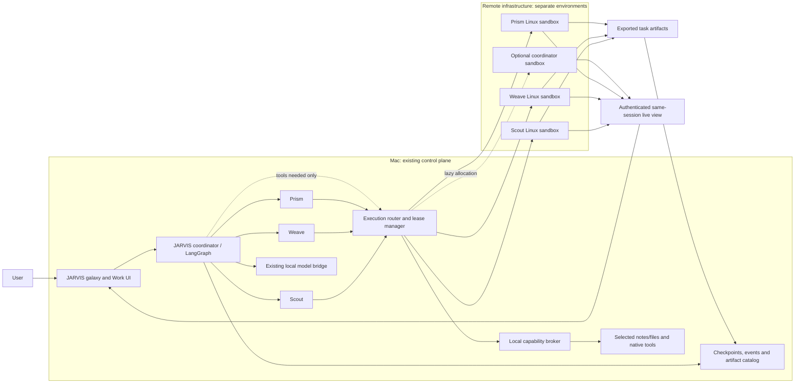

# Remote execution for JARVIS

Investigation date: **23 October 2026**. Status: **recommendation and proof-of-concept specification; not an implemented remote integration**.

## Verdict

**Feasible, with a new execution adapter and session manager.** Keep the current JARVIS interface and LangGraph workflow. Give each worker a separately leased remote environment, rather than starting another agent framework. Start with E2B Linux sandboxes; use its desktop template when a visible browser or Linux GUI is needed. Preserve local tools through JARVIS's existing local registry.

This separates where a model is coordinated from where its actions execute. Initially, the coordinator and model connection still run on the Mac; code, browsers and GUI actions run remotely. JARVIS will therefore still need the Mac awake and connected. Independent operation while the Mac is off requires a later move of the control service and an outbound local-resource connector. A remote desktop alone does not provide that independence.

No provider account was created, paid infrastructure provisioned, remote SDK installed, or remote workflow benchmarked during this investigation. Runtime code and private configuration were not changed. Prices and features below were checked against public sources; reliability and startup targets remain to be tested.

## What the actual system does today

Inspected checkout: `jarvis`, `main`, starting revision `ed59254`. Relevant code and the running loopback server were inspected without reading or exposing `config.json`.

| Area | Evidence in this checkout | Consequence for remote execution |
| --- | --- | --- |
| Task assignment | [`workflow_graph.py`](../workflow_graph.py), `compile_workflow`, lines 17–33: retrieve → assign → parallel `Send` workers → review; SQLite checkpointer | Keep the graph. Attach environment leases to worker invocations, not to a replacement orchestration framework. |
| Three workers | [`workflow_runtime.py`](../workflow_runtime.py), `GraphJobs.worker`, line 277; `WORKER_COUNTS` | These are task-scoped worker slots. Scout, Weave and Prism are their UI identities, not three independent background computers. General uses one worker, research three, document/code two. |
| Admission/session ownership | `WorkflowService.__init__`, line 303, and `start`, line 425; [`server.py`](../server.py), `MAX_PARALLEL_BRAINS = 1`, line 129 | One workflow can fan out to three workers, but independent workflows cannot currently run together. `active`, `thread`, `bridge` and cancellation state must become per-run before admitting multiple workflows. Simply increasing the semaphore is insufficient. |
| Tool execution | `GraphJobs.tool`, line 165; [`ultra_tools.py`](../ultra_tools.py), `SPECS`, line 35; `server.py`, registry at line 860 | The Work route permits only `notes_search`, `note_read`, `preferences_get`. It explicitly prohibits shell, arbitrary files and browsing. Other chat tools cover notes, preferences, Focus, screen-watch control and document import. No general browser, shell or desktop input tool is registered. Remote computer capabilities must be added explicitly. |
| Model connection | [`codex_bridge.py`](../codex_bridge.py), subprocess at line 220, thread configuration around line 290 | The installed local CLI runs an app-server connection with read-only, ephemeral model threads and registered JARVIS tools. It does not automatically give workers computers. Keep this connection local initially; copying login material into guests is not part of this plan. |
| Existing local computer integration | `server.py`, Focus/screen-watch callbacks; `focus_reader.py`, `native/`, `voice_bridge.py`, viewer display sharing | Screen observation and Focus are host-specific. Screen watch is not a general mouse/keyboard controller. Keep native helpers local. A shared physical Mac cannot support three simultaneous independent cursors; future local GUI actions need an exclusive lease. |
| Cancellation | `WorkflowService.cancel`, line 517; `GraphJobs.tool`, lines 181–205 | Cancellation is cooperative. A timed-out callback thread can continue after JARVIS stops waiting. Remote cancellation needs process termination and/or environment deletion with acknowledgment. |
| Durability | `RunStore`, line 87; `initialize`, line 318; `_execute`, line 465 | Existing SQLite checkpoints recover graph state and mark interrupted runs. They do not capture browser memory, OS processes or remote leases. Add an environment ledger and reconciliation. |
| Limits | Running `GET /workflows`: enabled/available, `concurrent_runs: 1`, `max_workers: 3`, `request_timeout_s: 240`; settings default worker timeout 45 s; 24 tool calls and 256 retained events | Desktop provisioning and long tasks need distinct budgets. Preserve existing limits for current tasks. Long workflows also need a durable event log rather than relying on the bounded UI event list. |
| Monitoring UI | [`viewer/agents.js`](../viewer/agents.js), worker identities at line 8 and Work navigation at line 154; [`viewer/workflows.js`](../viewer/workflows.js), activity at line 70, SSE at line 83 | Reuse real events and existing start/cancel/retry controls. Add environment/session identity and a Watch pane in Work. Keep live video out of the compact galaxy card. |
| Deployment/dependencies | [`start-workflows.sh`](../start-workflows.sh), [`tools/run_workflows.py`](../tools/run_workflows.py), [`requirements-ultra.txt`](../requirements-ultra.txt) | Local Python service/venv and plain JavaScript; no existing cloud provisioning or deployment configuration supplies remote computers. LangGraph 1.2.16 and SQLite checkpoint 3.1.2 are pinned. Repository rules require approval before adding server dependencies; HTTP adapters or an isolated optional helper avoid changing the ordinary server's dependency contract. |
| Host capacity and access | Host inspected as Apple Silicon, Darwin 27, **8 GiB RAM**; server binds `127.0.0.1` and validates Host/Origin | Several local desktop VMs would compete with the host. Do not expose the personal HTTP service publicly as a remote-agent gateway: same-origin checks are not remote-user authentication. |

The separate legacy chat path in [`ultra.py`](../ultra.py), including its three-worker executor around line 758, also shares the tool registry/model admission. Keep it functional and route any future remote tools through the same execution boundary, rather than giving the two paths competing environment managers.

### Prerequisites and blockers

There is no architectural blocker to a three-worker remote proof of concept. The missing pieces are real: environment lifecycle APIs, remote action tools, action ownership, live-view authorization, artifact transfer and cleanup after host failure. The current workflow tool boundary intentionally prevents these actions.

Before a hosted trial, a provider project, securely configured credentials, a region, quotas, an explicit trial spending cap and any new dependency approval are needed. Provider credentials/credits were not inspected or assumed available. No decision is required merely to complete this recommendation.

Additional blockers depend on scope: Linux cannot run native macOS applications; four persistent macOS computers need suitable Apple hardware/provider capacity; and continued reasoning while this Mac sleeps requires moving the control plane and separately validating its model access. File access must be deliberately granted, not inherited from the Mac's home directory.

## Strongest candidates and what each supplies

### E2B — recommended first implementation

Repositories: [SDKs](https://github.com/e2b-dev/E2B), [desktop template/examples](https://github.com/e2b-dev/desktop), [runtime](https://github.com/e2b-dev/runtime). The former `infra` repository redirects to `runtime`. All three report Apache-2.0 and active, non-archived repositories at inspection. Desktop SDK code now lives in the E2B monorepo, not just the desktop repository.

E2B provides the environment infrastructure: Firecracker microVMs, command/file APIs and lifecycle management. Its desktop package adds Linux screen capture, keyboard/mouse input and an authenticated noVNC stream. The SDK's stream controls and screenshot actions use the same sandbox display; a headed browser must run on that display for Watch to show the browser being controlled. This is not an orchestration layer. [Runtime source](https://github.com/e2b-dev/runtime), [desktop SDK source](https://github.com/e2b-dev/E2B/blob/d1fbe13c2a86198ca087e0c63966592388f2dc58/packages/desktop-python/e2b_desktop/main.py).

Lifecycle: create from a pinned template, record sandbox ID against run/worker, execute commands and transfer files, reconnect by ID, and kill on completion. Memory/disk pause is supported, but paused sandboxes have **no automatic deletion**. A pause may fail with a busy/503 response while snapshot work finishes, leaving the VM running. JARVIS must confirm transitions and explicitly reap paused environments. External TCP sessions and website logins still need application-level recovery after suspension. [Persistence documentation](https://docs.e2b.dev/sandbox/persistence).

Important source-level details: `stream.start(require_auth=True)` must be explicit; the default is unauthenticated. `get_url(view_only=True)` merely adds a client query parameter. It is not a server-enforced input permission. Use an input-filtering gateway/VNC policy and short-lived viewer authorization; do not treat hiding controls as security. Only one stream instance runs per desktop, which is compatible with one per worker. End-to-end GUI readiness is unmeasured; API creation latency is not usable-browser latency. [Stream implementation](https://github.com/e2b-dev/E2B/blob/d1fbe13c2a86198ca087e0c63966592388f2dc58/packages/desktop-python/e2b_desktop/main.py#L132).

Self-hosting is possible with Apache-2.0 E2B Embed. Current instructions require Linux with hardware virtualization, recommend 12 GiB RAM and 20 GiB disk, and expose HTTP without built-in TLS. ARM support has kernel/page-size requirements. Mac installation requires a suitable nested Linux VM; this 8 GiB host is below the recommended memory before three GUI guests. A separate Linux server is the sensible self-host target. Single-node operation also means operating patches, disks, backups, networking and recovery yourself. [Embed overview](https://github.com/e2b-dev/runtime/tree/main/embed), [installation requirements](https://github.com/e2b-dev/runtime/blob/main/embed/compose/README.md).

**Fit:** one provider can cover command execution, browser work and visible Linux applications. Main integration gaps: JARVIS tools, safe viewing/takeover, durable leases and cleanup. Native macOS/Windows applications are outside this desktop template.

### Browserbase + optional Stagehand — strongest browser-only alternative

[Stagehand](https://github.com/browserbase/stagehand) is an MIT browser automation library; **the hosted Browserbase fleet is a separate service**, not infrastructure supplied by that repository. Stagehand adds model-driven browser actions. Initially use Playwright/CDP actions driven by JARVIS's existing planner; another autonomous agent loop would add model spending and competing retry policies.

Create a Browserbase session, bind its session ID to a worker, connect Playwright over CDP, and fetch that same session's debug Live View. Live View is interactive and embeddable; select the matching page/tab URL, not an unrelated default tab. Its documentation's CSS `pointer-events` read-only example is UI behavior, not an access-control boundary. Stop agent dispatch before human input. [Live View](https://docs.browserbase.com/platform/browser/observability/session-live-view).

Default disconnect ends a session. Paid `keepAlive` allows reconnect until its timeout; explicit `REQUEST_RELEASE` ends it. Paid standard sessions support up to six hours. Contexts persist browser profile data, including sensitive authentication state; reserve one context per identity/workflow and serialize changes. Downloads must be retrieved from cloud storage through the API. These features preserve browser state, not a full OS desktop or arbitrary installed applications. [Reconnect/lifecycle](https://docs.browserbase.com/platform/browser/long-sessions/keep-alive), [timeouts](https://docs.browserbase.com/platform/browser/long-sessions/timeouts), [contexts](https://docs.browserbase.com/platform/browser/core-features/contexts), [downloads](https://docs.browserbase.com/platform/browser/files/downloads).

**Fit:** choose instead of E2B if measured tasks are overwhelmingly authenticated web work and managed browser features justify the subscription. A basic browser session is not general code/desktop infrastructure. Browserbase also markets a separate hosted Functions runtime; using it would be an additional deployment surface, not a capability of Stagehand.

### Daytona — viable hosted alternative, weak basis for a new open-source self-host

The commonly linked [daytonaio/daytona](https://github.com/daytonaio/daytona) repository was archived **3 October 2026**. Its notice says core development moved private in June 2026. The old tagged core is AGPL-3.0; it is not the maintained hosted backend. Current clients are in [daytona/clients](https://github.com/daytona/clients), not the archived `daytona/sdk`. SDK/client code is Apache-2.0; the CLI directory is AGPL-3.0. [Current license](https://github.com/daytona/clients/blob/main/LICENSE).

The hosted service supplies code/process/files, Linux desktop Computer Use and VNC, plus documented Windows and separate macOS offerings. Its GUI stack starts Xvfb, XFCE, x11vnc and noVNC. Assign by sandbox ID; stop/start retains files, while **container sandboxes cannot memory-pause**. VM classes support pause/resume. Delete explicitly, wait for confirmation and set independent expiry/auto-delete policies. Stopping the desktop stream is not deleting the sandbox. [Computer Use](https://www.daytona.io/docs/en/computer-use/), [persistence](https://www.daytona.io/docs/en/persistence/), [Linux lifecycle](https://www.daytona.io/docs/en/linux-sandboxes/).

**Fit:** broad hosted features, but current source openness and long-term self-host maintenance are worse for this requirement. Do not base a new maintained self-host deployment on the archived core. BYOC is a separate vendor arrangement; public SDK availability does not make the hosted backend open source. Mac/Windows capacity, application licensing and takeover semantics require their own trial rather than assuming Linux behavior applies.

### Cua / Lume — consider for native macOS tasks later

[trycua/cua](https://github.com/trycua/cua) supplies computer APIs, local/own-cloud runtimes and Lume Apple Silicon VMs. Spaces connects to computers you own with desktop streaming and input. SDK/CLI/Driver/Lume are MIT, but Spaces, `cua-spacesd`, streaming clients/codecs/viewers and related components use **FSL-1.1-MIT**, including a competing-hosted-service restriction and a two-year conversion. This is mixed licensing, not an entirely permissive MIT stack. [Licensing map](https://github.com/trycua/cua/blob/main/legal/LICENSING.md).

The current migration notice says Cua Cloud/Fleets ended **18 October 2026** and old `cua-agent`, `cua-computer` and related packages are unmaintained. Another cloud guide still says 16 October and retains old instructions: use the migration notice and current source, not old cloud examples. Own machines/cloud remain options. [Migration notice](https://cua.ai/docs/cua-sdk/guides/cua-cloud-ended).

**Fit:** useful if the task genuinely requires macOS apps. It entails Apple hardware, OS licensing/capacity review and more operations. Cua's host documentation limits a Mac to two macOS VMs; therefore one spare Mac is not a four-desktop solution. Native application licensing and permission prompts also remain. This is a later specialist adapter, not the default for note analysis, code or browser work. [Spaces placement](https://cua.ai/docs/spaces/reference/spaces).

### Useful components that are not remote-computer platforms

- [noVNC](https://github.com/novnc/noVNC): browser VNC client, not VM provisioning, isolation, authentication policy or agent orchestration. Core MPL-2.0, with separately licensed assets/dependencies. Prefer the provider's existing stream; retain notices if embedding/modifying its client. [License](https://github.com/novnc/noVNC/blob/master/LICENSE.txt).
- [browser-use](https://github.com/browser-use/browser-use), MIT: browser-driving agent software. It does not by itself provision an isolated desktop fleet or solve JARVIS session ownership. Avoid introducing a second agent planner for the first integration.
- AutoGen/Flowise or another LangGraph installation would not supply remote computers. Keep the graph already integrated in JARVIS; compute and viewing are separate concerns.

## Environment lifecycle and size choices

| Choice | Benefits | Costs/limitations | Recommended use |
| --- | --- | --- | --- |
| Fresh environment per task/worker | Clean browser profile/files, simple attribution and deletion, strongest separation | Template/browser readiness and login overhead; results must be exported | Default. Start from immutable prepared templates. |
| Persistent computer per agent | Keeps installed apps and login state; useful for extended projects | Idle charges or snapshot retention, drift, stale secrets, contamination between tasks, periodic rebuilding | Explicit named project workspace only; separate workspace from the agent's personality. |
| Reusable pool | Can reduce measured allocation delay under bursts | Pool health/reaping, lease races and clean-reset verification; idle capacity costs | Later, only if end-to-end startup measurements justify it. Rebuild/fork clean state before reassignment; never hand a dirty profile to another task. |

| Environment | Appropriate tasks in JARVIS | Viewing, persistence and OS tradeoff |
| --- | --- | --- |
| No remote machine | Current note search, summarization and final review | Existing tool timeline is enough. Creating a desktop adds cost without helping these operations. |
| Browser-only | Web research, forms, dashboards, downloads | Real interactive browser view; profile persistence separate from browser lifetime; cannot operate native desktop apps. |
| Container | Trusted code, document processing, tests | Low operational footprint, can add a Linux desktop, but ordinary containers share the host kernel. Use stronger isolation for agent-generated/untrusted execution; no Docker socket or host home mounts. |
| Linux microVM, optional desktop | Untrusted code, headed browser, Linux GUI apps | Separate kernel and disposable disk; a GUI adds RAM/processes. Good default remote boundary; no native macOS apps. |
| Full macOS/Windows VM | Platform-specific native apps or workflows relying on that OS | Heavier images, app/OS licenses, login/permission setup, more expensive or constrained hardware. Necessary only after identifying a concrete incompatible application. |

Startup times above are qualitative. No candidate's usable GUI startup, streaming latency, CPU load or task success rate was measured. Vendor millisecond allocation claims and community anecdotes are not desktop-readiness benchmarks. Persist artifacts/checkpoints outside the environment; snapshots alone are not disaster recovery.

## Community evidence and access limits

All links were accessed on 23 October 2026. Reddit displayed relative dates; its JSON endpoints returned 403, so exact post timestamps could not be independently retrieved. These are self-reported experiences, not controlled tests. Several threads contain vendor promotion, which was not treated as independent validation.

| Source and visible date | Firsthand report | Validation and effect on recommendation |
| --- | --- | --- |
| [Browserbase after 10k sessions](https://www.reddit.com/r/automation/comments/1sl1um7/browserbase_review_after_running_10k_sessions/), “6mo ago” | OP reports faster startup than their own Docker setup and useful Stagehand behavior, but complains about short-session billing. Claimed volume is unverified. | The one-minute minimum is confirmed in [official billing documentation](https://docs.browserbase.com/account/billing/plans). Budget rounded session duration; do not infer a general success rate from this thread. |
| [Long-running browser tasks](https://www.reddit.com/r/automation/comments/1mq9n9a/anyone_here_compared_hyperbrowser_with/), “1y ago” | OP describes hangs/resets after 30–40 minutes, stale DOM retries and fragile tab context. Another operator reports checkpoints every 5–10 actions and per-tab state checks. | Not proof of a current provider-wide timeout or unresolved defect. Official paid timeout is six hours; reconnection requires keep-alive. Test 45–50 minutes, tab identity and recovery explicitly. |
| [Sandbox lifecycle discussion](https://www.reddit.com/r/AI_Agents/comments/1unl2r3/how_are_you_actually_using_agent_sandboxes_like/), “3mo ago” | Discussion favors fresh clones/templates over state-contaminated long-lived boxes and raises internal-service access. A prominent responder discloses working for another sandbox vendor. | Useful checklist, lower independence. Do not accept its ~150 ms startup or blanket implementation claims as verified measurements. Local resources need a separate narrow bridge. |
| [Microsandbox technical discussion](https://news.ycombinator.com/item?id=44135977), 30–31 May 2025 | Operators describe friction integrating VM/container infrastructure and filesystem/networking; commenters debate isolation boundaries. | Historical operational context, not a benchmark of today's E2B Embed. Current installation docs confirm real KVM, kernel, networking and disk requirements. Managed compute avoids taking on that maintenance initially. |

X/Twitter was searched, but relevant post results could not be reliably retrieved and direct [E2B's X profile](https://x.com/e2b_dev) returned 403. No X post is represented as evidence. Public GitHub source and official docs were accessible; provider dashboards, paid support, private issues and independent production metrics were not. Browserbase Markdown pages rejected by the web reader were successfully read through direct public HTTP retrieval. Cua's obsolete `docs.cua.ai` host failed; current `cua.ai/docs` pages were accessible.

## Recommended architecture

Use one execution provider first: **E2B on demand, fresh per task/worker, prepared templates, explicit cleanup**. Benchmark it before committing to ongoing use. Browserbase is the alternative for a browser-heavy workload, not a mandatory additional layer.

The three agents can perform remote actions concurrently inside the current fan-out. A coordinator workspace is allocated only when it actually needs tools; the existing final reviewer has no tool access and needs no VM. Independent simultaneous task assignments/coordinator work require the per-run scheduler phase below. Start with the current three-worker ceiling; a fourth concurrent environment requires an explicit quota/budget adjustment.

### Interfaces and boundaries to build

1. **Environment provider:** `acquire`, `inspect`, `exec`, `browser_action`, `desktop_action`, `upload/download`, `view_session`, `stop_process`, `pause/resume`, `destroy`. Declare capabilities instead of pretending all providers pause or run the same OS. A small optional adapter/helper can keep SDK dependencies outside the stdlib server.
2. **Lease record:** provider, environment ID, run ID, worker slot, generation, template/version, status, deadline, heartbeat and artifact manifest. Persist immediately after allocation; handle ambiguous create responses by reconciliation/idempotency tags so a network retry cannot create an untracked paid VM.
3. **Tool router:** JARVIS, not model-supplied arguments, selects the owning lease. Add typed remote tools with bounded arguments/output. Do not remove `READ_TOOLS` globally: introduce an explicit remote-capable workflow policy alongside existing read-only analysis. Keep deterministic browser operations before screenshot-based input where practical; both must target the same headed browser/display.
4. **Local resources:** initially the model controller is local, so it can call approved existing local tools directly; no remote guest needs inbound access to the Mac. For remote code needing files, export only a task-scoped bundle/allowed file IDs, then import selected artifacts. Never mount the whole home directory, browser profile, local socket or config. File grants explicitly identify data that may leave the Mac. Check revisions before local writes.
5. **Future remote controller:** use an outbound authenticated local connector with short-lived, run-scoped capabilities and allowlisted operations; return unavailable when the Mac is asleep. Do not tunnel port 4700 or grant broad LAN access. Bind identities, enforce quotas and retain redacted audit events. Provider/model master credentials remain outside guests; use least-scope task credentials or mediated calls.
6. **Watch and input ownership:** add a Work detail pane with the real environment ID, display/tab identity, last frame/heartbeat, logs, files and timing. The compact Scout/Weave/Prism card stays compact; clicking opens Watch. Use server-authorized view sessions and filtered input; provider API keys and VNC passwords must not enter ordinary event logs, shareable URLs or persisted HTML. Raw desktop frames can contain sensitive data and require access controls; text redaction does not sanitize every image.

### Pause, takeover, stop and recovery semantics

- **Pause agent:** acknowledge the action boundary, stop dispatching new actions and finish/terminate the in-flight operation. The desktop stays alive so the user can act. It does not undo an already-submitted web request.
- **Take control:** revoke the agent's input lease, grant the human an exclusive interactive lease, and reject late actions from the old generation. On handback, capture fresh screen/DOM/tab state and replan. A mouse-enabled VNC viewer alone does not prevent races.
- **Suspend computer:** optional provider memory pause to save active compute. There is no live desktop while it is suspended. Confirm provider status; a refused pause must not be shown as paused. Browser/network credentials can expire while suspended.
- **Stop task:** cancel model turns, terminate remote processes, collect any safe partial results, destroy/release the environment, and confirm cleanup. Stop streaming alone does not stop work or billing. If deletion fails, show cleanup pending and retry with bounded backoff.
- **Reconnect:** losing Watch/SSE is separate from losing execution. Reconnect to the recorded environment/session if alive. If lost, restore durable files/checkpoints in a new environment, visibly report the restart, and verify uncertain writes before retrying. No promise of restoring external connections or exactly-once web side effects.
- **Host failure:** provider-side hard expiry must terminate running compute even when the Mac cannot send heartbeats. Do not auto-pause disposable environments into indefinite retention. A remotely scheduled reaper is required before enabling retained paused environments; reconcile both running and paused inventory on every restart.

## Concrete task walkthrough

Example future task: “Use this selected CSV, compare three public sources, calculate a summary and save a report.” This is beyond today's read-only Work tools and is a proposed POC workflow, not a claim that it already runs.

1. In JARVIS Work, assign the task and select the CSV grant. The coordinator records a plan: Scout collects sources, Weave computes CSV statistics, Prism checks the findings. Each gets only its required data/tools.
2. The router creates three clean, tagged leases with hard deadlines. Scout/Prism receive a desktop/browser template; Weave receives a code template unless a GUI is required. Prepared dependencies avoid repeated installation. JARVIS emits provisioning, ready and agent-start events based on provider responses.
3. Click Scout → Watch to see the same browser it is using. Select another agent to view its own session. The galaxy card shows real concurrent activity and handoffs, while the larger pane displays tool calls, errors, timing and artifacts.
4. If a page requires human input, pause the agent, acquire control, complete the action and hand back. JARVIS rereads the changed page before continuing. Scoped local note access still runs through the local registry; arbitrary guest access to the Mac is denied.
5. Export the report, source manifest and CSV result with hashes and size/type checks into a quarantined task-artifact directory. Treat filenames and content as untrusted. Do not execute returned files automatically. The reviewer uses confirmed results and citations.
6. Close input/view grants, destroy environments, verify provider inventory, and retain the report/checkpoint plus redacted audit summary in JARVIS. Mark complete with cleanup status; failed cleanup stays visible and is retried.

## Phased implementation tied to this codebase

| Phase | Concrete changes | Exit condition |
| --- | --- | --- |
| 1. Isolated optional adapter | New `execution_provider.py` interface plus E2B helper/HTTP adapter; separate `environment_store.py`; template pinning, deadlines, artifacts, independent expiry. Integrate acquisition around `GraphJobs.worker` in `workflow_runtime.py`. | A deterministic remote command and real headed browser action complete through the adapter with confirmed cleanup, without changing existing note workflows. |
| 2. Three-worker POC | Extend typed policies in `ultra_tools.py` and `workflow_runtime.py`; persist run/slot/lease associations; route local vs remote calls and enforce budgets. Preserve `codex_bridge.py` model transport. | Three workers execute distinct tasks concurrently with isolated files and browser profiles; all POC criteria below pass. |
| 3. Live monitoring and control | Add environment state/events and authenticated view/control endpoints in `server.py`; extend `viewer/workflows.js`, `viewer/agents.js`; implement action lease/generation, pause/handback and process cancellation. | Real Watch pane, correct session selection, safe takeover, reconnect and explicit cleanup status. No galaxy-sized video overlay. |
| 4. Independent assignments and durability | Replace singleton run ownership in `WorkflowService` with per-run records/queues, budgeted global agent slots and per-local-resource locks. Extend graph state only for stable lease references, not connection objects. Add durable event cursor/gap handling beyond 256 events. | Concurrent workflows cannot overwrite bridge/cancel state; crashes reconcile orphan leases and uncertain operations. |
| 5. Optional expansion | Remote coordinator deployment plus outbound local connector if Mac-off operation is required. Consider E2B Embed on a separate Linux host; add Cua/macOS only for a demonstrated native-app requirement; add warm pools only after latency measurement. | Authentication, model access, local offline behavior, backup and independent cleanup validated before wider use. |

Rough engineering estimate, not a quote: 3–5 focused days for an adapter and deterministic POC, then another 1–3 weeks for reliable takeover, scheduler changes, authorization, recovery and UI polish. Mac/Windows support, remote coordinator operation and production hardening expand scope. Keep remote execution behind a feature flag with the current local analysis route as rollback.

## Minimal proof-of-concept plan and acceptance criteria

No provider tests below were executed. Use synthetic data and a private fixture website inside the test environment. Do not test account purchases, production writes, real credentials or arbitrary local files.

Suggested future cap: **three concurrent environments, no automatic over-cap provisioning, at most two aggregate environment-hours, $5 infrastructure ceiling, and existing model/tool limits**. The $5 is a proposed cap to approve/configure before provisioning, not current spending authorization. Allow one separate 45–50 minute browser trial within that aggregate budget. Do deterministic adapter tests first, then one short model-driven end-to-end task. Long fixture tests can exercise orchestration with deterministic actions without adding model calls.

| Test | Acceptance criterion |
| --- | --- |
| Current functionality | Existing offline/live preflight and visible Focus probe still pass; note analysis stays read-only and current UI controls work. |
| Concurrent agents | Three actual leases overlap in time, use distinct IDs, files and browser profiles, and return correct fixture outputs. A fourth acquisition is queued/rejected at the configured cap. |
| Correctness/artifacts | CSV statistics and report match known fixture values; manifests/hashes agree; a failed or uncertain action cannot be reported as completed. |
| Same-session live view | A unique nonce typed by each agent appears in its own watched browser/desktop. Manual input after takeover appears in the agent's next observation. Wrong-tab and cross-agent viewing attempts fail. |
| Responsiveness | Record allocation → desktop ready → browser ready separately, plus action latency and frame delay. Initial targets, not guarantees: ready browser p95 ≤30 s over 10 starts, frame delay ≤2 s on the chosen region/network. Reassess targets from evidence. |
| Local access | One expressly granted fixture is readable/exportable; sibling files, traversal, config, another worker's lease and ungranted writes are denied. Revocation stops subsequent access. No guest/provider key is shown in UI events. |
| Pause/takeover | Pause acknowledgment ≤2 s when between actions; no next action starts afterward. For an in-flight action show pausing until completion/termination, with a 5 s hard-stop target for fixture processes. Old-generation delayed input is rejected after human takeover. |
| Failed tools/retries | Inject tool timeout, process exit, rate-limit/503 and malformed output. Bounded retry/backoff, explicit errors and original budgets hold. Never blindly repeat a fixture non-idempotent write after a lost acknowledgment. |
| Lost viewing/network | Disconnect Watch for 30 s; reconnect to the same live session with no duplicate task. Drop the action connection after an acknowledged and an unacknowledged write and verify reconciliation. |
| Long task | Run 45–50 minutes with multiple tabs, one browser restart, checkpoints and expiring fixture login. Report exactly what survives; do not infer six-hour reliability. |
| Host/process interruption | Stop/restart JARVIS's test controller; recover/reconcile leases without duplicate allocation. Simulate Mac offline; provider hard expiry stops running compute independently. |
| Cancellation and cleanup | Cancel during provisioning, command execution and takeover. Running process stops and provider inventory confirms deletion within 60 s in normal connectivity. Under outage show pending cleanup; no remaining running VM after its ≤15 min post-heartbeat deadline, and no retained paused VM. |
| Resource/cost accounting | Record wall time, worker overlap, CPU/RAM high-water marks where exposed, event/frame volume, sandbox seconds, model calls/tokens when available and provider usage reconciliation. Run the same fixture locally and remotely; report measurements separately from estimates. |

A successful POC does not establish production reliability. Do not call the integration complete until agent-driven tasks, real same-session viewing/control, local grants, recovery and cleanup work together in JARVIS.

## Costs: public rates versus estimates

USD, checked 23 October 2026. Taxes, currency conversion, existing model usage/subscription, proxies/egress, extra storage, backups and engineering time are excluded unless stated. No charge was incurred for provider infrastructure in this investigation.

**Verified E2B rates:** default 2 vCPU + 4 GiB RAM cost `2 × $0.000014 + 4 × $0.0000045 = $0.000046/s`, or **$0.1656 per active environment-hour**. Hobby has no plan subscription, a one-time $100 credit, 20 concurrent environments and one-hour sessions; Pro is **$150/month plus usage**, supports 24-hour sessions and custom sizes. Listed included disk is 10 GiB Hobby / 20 GiB Pro. Credits are not a recurring discount. [Published pricing](https://e2b.dev/pricing).

| E2B scenario at that size | Assumption | Compute estimate before credits |
| --- | --- | --- |
| Minimal three-agent demonstration | Three environments × 15 minutes | $0.12 |
| Entire proposed POC allowance | Two aggregate environment-hours | $0.33; $5 proposed cap leaves room for overhead, but model calls remain separately bounded |
| Three workers, moderate use | Each active 1 h/day × 22 days = 66 environment-hours | $10.93/month on Hobby if every session fits its limit |
| Same use plus coordinator workspace | Four × 1 h/day × 22 = 88 environment-hours | $14.57/month on the same assumptions |
| Three desktops active continuously | Three × 730 h = 2,190 environment-hours | $362.66 compute; uninterrupted month-long sessions exceed listed Hobby/Pro duration and need restart/enterprise design |
| Four desktops active continuously | Four × 730 h = 2,920 environment-hours | $483.55 compute, with the same session-duration caveat |

If Pro is needed, add $150/month to the applicable usage estimate. Paused snapshot retention/storage conditions must be confirmed for the chosen plan; this report does not assume unlimited free retained desktops. GUI RAM sizing is an assumption to validate, not a measured requirement.

**Verified Browserbase pricing:** Developer $20/month includes 100 browser-hours and 25 concurrent browsers, then $0.12/hour; Startup $99 includes 500 hours and 100 concurrent, then $0.10/hour. Developer proxy allowance is 1 GB, then $12/GB. Time is rounded by minute with a one-minute session minimum. Free permits three concurrent browsers, one included hour and 15-minute sessions; it does not provide paid keep-alive. [Pricing](https://www.browserbase.com/pricing), [billing units and limits](https://docs.browserbase.com/account/billing/plans).

At 66 browser-hours/month the browser-only estimate is $20 Developer, excluding proxies/model calls; at 2,190 browser-hours Developer would be $270.80 before extras. This is not comparable to a general desktop VM: only use it for browser tasks, and sessions still have time limits.

**Daytona:** published Linux compute rates are $0.0504/vCPU-hour and $0.0162/GiB RAM-hour: also $0.1656/hour at 2/4. Storage is listed at $0.000108/GiB-hour after its included allowance; Windows has an additional listed $0.0858/vCPU-hour charge. Verify class, storage retention, regional capacity and account terms before applying these to a specific configuration. No verified macOS or BYOC quote was obtained. [Pricing](https://www.daytona.io/pricing).

**Self-hosting estimate:** a separate 16–32 GiB Linux/KVM-capable host might cost roughly $30–$120/month depending on provider/location, plus storage/traffic and maintenance. This is a planning range, not a verified offer; many ordinary cloud VMs do not expose the needed virtualization. Size three 4 GiB guests plus runtime/host overhead and measure CPU contention. Mac/Windows desktops require separate hardware/OS/app cost evaluation. Current Mac power use is not a substitute for remote capacity.

No new model price is assumed. Keeping the existing model bridge avoids introducing another model provider, but additional tool cycles/images consume existing limits. Record calls/tokens where available; an account subscription does not yield a trustworthy per-task dollar cost by itself.

## Verification performed here

- Source/configuration inspection, public running capability check, upstream README/SDK/license inspection, official documentation/pricing research and community review.
- Existing full live preflight: **`14 pass, 0 fail, 2 warn`**. The two warnings are intentionally skipped direct-API checks because the configured model route uses the local CLI.
- Visible browser probe, asserted actual CSS viewport 1440×900: **`FOCUS PROBE: 16 pass, 0 fail | 1440x900`**. All per-case title checks passed, including visible-at-finish. Temporary viewport override was reset and probe tab closed.
- These results validate the existing local system, not remote-provider reliability. No remote latency, model-cost comparison, takeover or remote stress result is claimed.

## Reproducible upstream source snapshot

Public repository default-branch commits inspected on 23 October; recent pushes establish activity, not quality or support guarantees:

| Repository | Commit |
| --- | --- |
| E2B SDK/desktop SDK | `d1fbe13c2a86198ca087e0c63966592388f2dc58` |
| E2B desktop examples/templates | `0df28963204554904c8fcc09e28c8bb4ed80b795` |
| E2B runtime | `3996d14cf2ee9f938508b70d1f0f71a4fc6a5235` |
| Daytona current clients | `81c9f87b3233f050250a835b913ce828df9cb049` |
| Cua | `ac7a167431329ae04a09dbb7332360cb4e5f4d61` |
| Stagehand | `8023f34161d650c196dc343d2c232fb5e129a826` |
| noVNC | `e8b5024d4603587b29ffede4fbd28b1fa2939829` |

Use pinned releases/commits and preserve component licenses/notices during implementation. No upstream source was incorporated into JARVIS runtime in this task.
