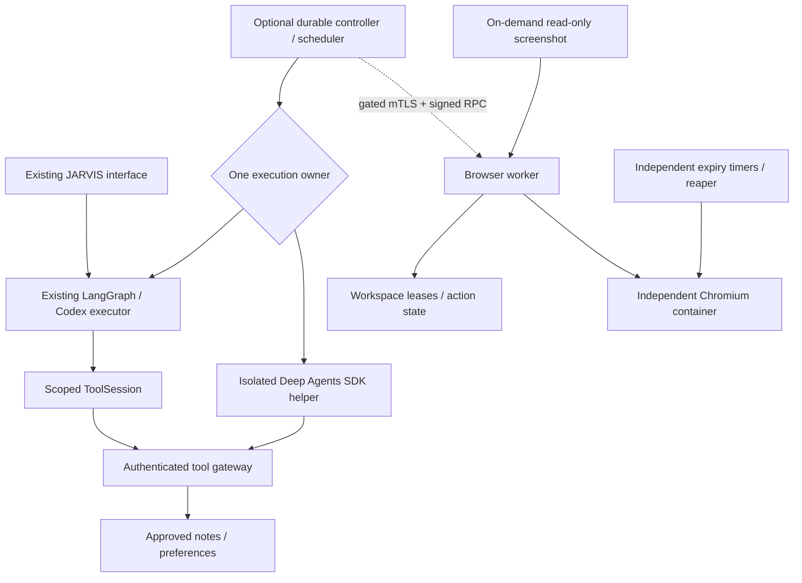
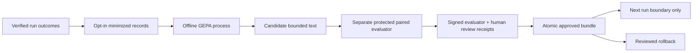

# Execution, workspace and learning contracts

This is a gated implementation, not a deployed service. The existing interface, signed-in Codex model route, identities, typography and animations remain in place. Recursive delegation and larger admission limits remain disabled. New controller/worker paths are not connected to the viewer.

## Ownership and authentication

`ControlStore` is a trusted controller library, not an agent tool. It alone issues opaque execution credentials, stores their hashes, pins versions, bounds child scopes and shared budgets, and fences stale generations. Worker names are display metadata. Root capabilities and evaluator/reviewer keys must not be passed to prompts. Local SDK frames use keyed MACs, strict sequences and byte limits; tokens are not in model messages. Worker RPC additionally requires mutual TLS, bounded signed timestamps and a durable nonce replay cache. Each service must run under the documented OS ownership boundaries; same-user filesystem access is not a hostile-code sandbox.

Adapters expose capability discovery, start, status, events, cancellation and resume. `LangGraphAdapter` preserves existing checkpoint recovery. `DeepAgentsAdapter` explicitly does not support safe resume/pause/Watch. Whole helper process-group exit is confirmed on cancellation. Queued scheduler admissions are durable and idempotent; a missing payload after a crash becomes interrupted. Client connections do not own execution lifespan. A controller restart fences running tasks; it does not silently replay them.

The tool gateway validates registry schemas/features, authenticated run ownership, child scope, deadline, cancellation, classification and shared counters before execution. Completed operation IDs deduplicate results. Pending operations stay uncertain and cannot be retried automatically. Source revision checks remain in note writes and workflow recovery. A late callback cannot settle a fenced operation. This is not an exactly-once guarantee for websites. No consequential external-effect tool is enabled.

The existing Ultra sessions, graph read tools, `/tools/call`, and native note/capture/preference/import writes use this gateway. Native writes retain the original local-origin, approval and feature checks and work independently of Ultra's tool switch. Their private registry is never advertised to models. Native edit/capture replay receipts are checked against current stable source identity and revision before refreshing the graph; changed or missing sources require reopening the note. The original maximum Unicode edit remains supported. Native payload/receipt limits differ from bounded model passages, without expanding model tool limits.

The optional HTTP `operation_session` key binds a request to its payload and retains its journal across retries. MCP derives an opaque key from its transport request identity and a process-private nonce; each RPC gets a new bounded budget. Repeated identities with different payloads are rejected. The Context parameter is injected by MCP and absent from the model schema. Its nonce is not persisted, so this does not establish task ownership or replay identity across an MCP process restart. Work uses durable request keys; replay of an unchanged form returns the original run even after completion. Native UI retries retain their keys while that form/dialog remains open; reloading does not persist an unfinished form.

**Legacy calls omitting replay keys still create a new session**, for compatibility. Replay keys are not remote authentication credentials. Fully authenticated request ownership across restartable MCP contexts and all local capability/transport routes remains unfinished. Existing loopback trust does not qualify as remote user authentication; Phase B acceptance is not passed.

## Durable state and source evidence

Control SQLite records separate runs, identities, append-only event sequence IDs and tool operations. Scheduler payloads/results have separate tables. Workspace SQLite owns task/worker/session IDs, generation, expiry, limits, action state and cleanup. Existing graph transcripts/checkpoints remain private and separate from notes and learned procedures. Stable source IDs hash the vault-relative identity, with separate content revision tokens. Public workflow citations resolve to the current numeric graph ID only when identity and revision still match. Changed sources are labelled historical; recovery refuses remapped/stale source IDs.

Lifecycle transitions: queued → running → waiting/running → cancelling → cancelled; running → complete/failed/interrupted. Terminal runs cannot be resurrected. Cleanup is tracked independently. Graph cancellation fences result delivery and retains the shared admission slot with cleanup pending until its callback returns. Codex interruption requires a terminal event or helper-process termination. An independent SDK supervisor enforces helper expiry even while a gateway callback settles; the callback still retains execution ownership. General native/thread work cannot be forcibly killed; this limitation is distinct from helper-process termination.

## Deep Agents runtime

Pinned official SDK `deepagents==0.7.32`, separate CPython 3.12 environment and hash lock. An actual SDK graph explicitly supplies tools, middleware, backend and one compiled Scout worker. No nested Ultra planner. Main and child tool scopes receive separate controller-issued credentials with shared parent budgets. The child graph cannot delegate. Only registered note search/read and explicit preference reads cross the gateway. Virtual scratch has file/byte/name limits; it cannot touch the host. Native filesystem/shell tools are hidden and rejected by middleware; the backend is ephemeral state and has no shell runtime. Automatic permanent memory, downloaded skills, hooks and hosted tracing are absent.

The research procedure is declared in `optional/deepagents/procedure.json` with purpose, tools, dependencies, environment, scope, inputs, outputs and verification. Live admission pins its content hash. It is implemented in the helper: search, read revisioned evidence, use bounded scratch, return evidence-backed JSON through the existing validator. Runtime dependencies are supplied by the lock, not by merely reading a skill file. The live provider path requires an explicitly pinned model plus a separately authorized `JARVIS_DEEPAGENTS_API_KEY`; no key is read from the existing configuration or Codex login cache. Token accounting is checked after every returned turn; a provider turn may consume tokens before reporting them. Exact pre-call token/cost reservation and provider cancellation/context behavior still need live validation. Fixture tests are not a model capability claim.

## Browser workspace boundary

The provider uses digest-pinned Selenium Chromium, independent containers/profiles, an internal Docker network, no host mounts, no published VNC, a loopback WebDriver endpoint, CPU/RAM/PID/tmpfs limits, and independent systemd expiry. Container and network disappearance are confirmed before marking cleanup complete. Failed creation, pending actions and failed teardown persist for reconciliation. These are shared-kernel containers, not general hostile-code VMs.

Only a trusted synthetic page, title inspection and exact-session screenshots are currently enabled. External navigation, element input, file transfer, Webtop and takeover are deliberately unavailable pending acceptance tests. `public_url` rejects schemes, private/metadata/mixed DNS destinations and unexpected hosts, but it is not represented as complete browser egress enforcement. An actual vetted proxy/firewall design with redirect/rebinding tests is still required before external navigation. Watch is server-enforced screenshot-only; opening it cannot create a session or send input. Live VNC/video streaming, viewer session/cookie integration, click/type authorization and exclusive takeover are unfinished.

## Learning and evaluation

`LearningStore` accepts only whitelisted scalar version/latency/usage fields and evidence hashes. Missing cost/usage stays unknown. No raw prompt, transcript, note, recording, credential, or audio field is accepted. Collection is off by default. Graph outcomes use the local hook; the common scheduler hook supports either adapter with hashed project/conversation scope. Collector outages are recorded separately without blocking delivery. This does not grant access to private histories or preferences. Deletion removes local derived records and vacuums the store; private backups must follow a separate retention/deletion policy.

The isolated GEPA integration operates only on approved training/development inputs through reviewed callables. Protected examples, promotion tools and keys are not part of its interface. No arbitrary import hook, optimizer pickle loading, checkpoint resume or application-code mutation. The fixture uses a scripted proposal and synthetic scoring; it measures plumbing only.

Promotion requires a hashed/expiring bundle bound to scope, parent, requirements and evidence; a signed complete paired report; zero critical failures; family floors; at least eight protected cases repeated three times per arm; equivalent budgets; complete costs; and either the specified gain or cost-reduction threshold. A separate reviewer signs the exact candidate and report hash. Parent comparison and activation are atomic. Consumed protected-set hashes cannot be reused. Rollback is reviewed. Automatic promotion has no serving route. The separate `execution_evaluation.py` runner executes all five arms three times per protected case, applies deterministic source/arithmetic checks, counts proposal plus all comparison costs, labels different endpoints as end-to-end comparisons, and computes paired case-cluster bootstrap intervals. Its 120 scripted fixture executions validate plumbing only. Actual model-backed evaluation, OS separation and complete cost accounting remain unverified. Canary monitoring and next-run serving activation remain unfinished, so synthetic signed reports cannot establish learned improvement.
